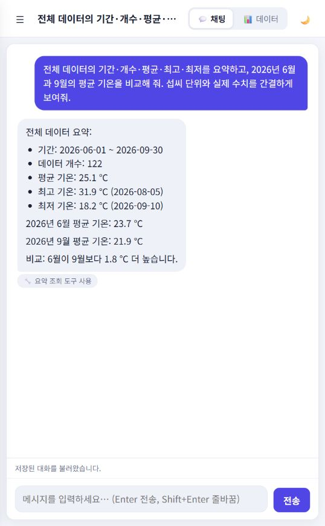
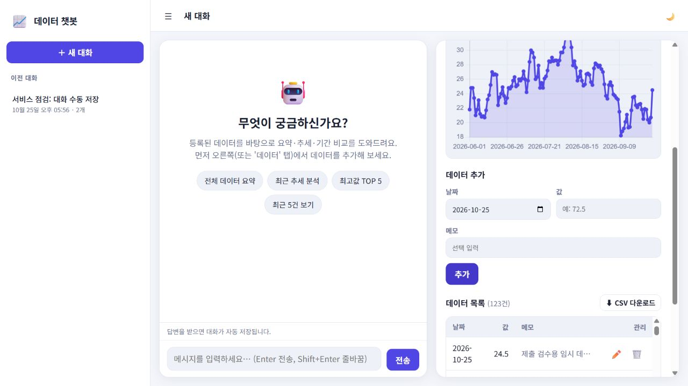
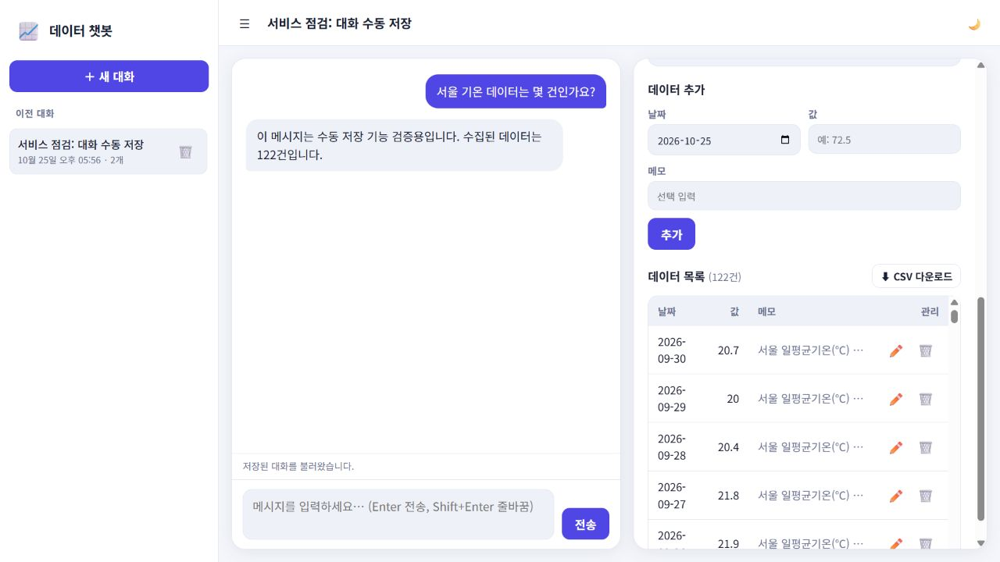

# 데이터 기반 AI 비서

저장된 서울 일평균기온을 조회·관리하고 GPT와 한국어로 통계와 기간을 비교하는 웹 앱입니다. FastAPI가 Firestore의 최신 요약을 system 메시지에 넣고, 필요한 경우 읽기 도구를 실행한 다음 질문과 답변을 자동 저장합니다.

원본 미션의 필수·보너스 요건별 구현 위치와 검증 범위는 [미션 대조표](docs/mission-audit-2026-10-27.md), 최신 검사 결과는 [인수 검사표](docs/acceptance.md)에 기록했습니다. 외부 계정 오류를 정상 AI 응답으로 대체하지 않습니다.

## 실행 주소

| 대상 | 주소 |
|---|---|
| 프론트엔드 | https://m1-2-codyssey-frontend.vercel.app (Vercel 팀 로그인 필요) |
| 백엔드 | https://m1-2-codyssey.onrender.com |
| Swagger | https://m1-2-codyssey.onrender.com/docs |
| GitHub 변경 검토 | https://github.com/jec5500-prog/M1-2-codyssey/pull/1 |

작업 브랜치는 `codex/ai-assistant-completion`이고, GitHub 저장소는 Public입니다. `main`에는 아직 병합하지 않았습니다. Render는 이 브랜치에서 배포하지만 Vercel은 Git에 연결되지 않은 수동 업로드입니다. **Vercel의 Require Log In이 All Deployments에 적용되어 비로그인 방문자는 앱 대신 Vercel 로그인 화면을 봅니다.** 사용자는 심사 자리에서 본인의 로그인 세션으로 시연하기로 했습니다. Render 무료 서비스는 유휴 후 첫 응답에 50초 이상 걸릴 수 있습니다.

## 기술과 기능

- Python 3.13.14, FastAPI, Pydantic, Firebase Admin/Cloud Firestore, OpenAI Python SDK.
- HTML/CSS/JavaScript, Chart.js 선 그래프. 프론트 프레임워크를 사용하지 않습니다.
- Render Python 웹 서비스, Vercel 정적 프론트, 로컬 stdio MCP 서버.
- 데이터 CRUD, 날짜 범위 조회, 개수·평균·합계·최소/최대·최근값·최근 7건 추세.
- 대화 수동 저장 API와 AI 자동 저장, 목록·복원·삭제, 로딩/실패 안내.
- 기간 비교·최근 원본·최고/최저를 위한 Function Calling, CSV, 다크 모드.

질문 → `POST /api/chat` → Firestore `data`의 최신 요약을 시스템 메시지에 포함 → 필요 시 모델이 읽기 도구 호출 → GPT 답변 → Firestore `conversations`에 자동 저장 → 목록/상세 API로 복원하는 구조입니다. 데이터 요약 API와 도구 호출은 같은 통계 서비스를 사용합니다.

## 데이터

2026-06-01~2026-09-30의 서울 일평균기온 122건, 단위 ℃. Open-Meteo의 ERA5 재분석 자료이며 관측소 직접 관측값이 아닙니다. [원본·출처·이용 조건](datasets/README.md), [정제 CSV](datasets/seoul-temperature.csv)를 함께 제공합니다. 기온 합계는 단순 계산 지표입니다.

Firestore의 `data`와 `conversations` 컬렉션을 사용합니다. `firestore.rules`는 클라이언트 직접 접근을 거절하고 백엔드 Admin SDK가 IAM 권한으로 접근합니다. 공개 시연용 앱이므로 개인 정보나 비공개 대화를 입력하지 마세요. 사용자별 인증/분리는 이번 과제 범위에 포함하지 않습니다.

## 로컬 실행 — PowerShell

저장소 루트에서 실행합니다. 과제 기준은 Python 3.10 이상이며, 이 저장소와 배포는 Python 3.13.14에서 검증했습니다. Node.js 22는 프론트 테스트와 배포 설정 파일 생성에 사용합니다.

```powershell
python -m venv backend/.venv
backend/.venv/Scripts/python.exe -m pip install -r backend/requirements.lock.txt
Copy-Item backend/.env.example backend/.env
# .env에 아래 서버 전용 환경변수를 직접 저장
backend/.venv/Scripts/python.exe -m uvicorn main:app --app-dir backend --reload --port 8000
```

새 터미널:

```powershell
backend/.venv/Scripts/python.exe -m http.server 5500 --bind 127.0.0.1 --directory frontend
```

http://localhost:5500 에 접속합니다. `frontend/config.js`의 로컬 기본 API는 http://localhost:8000 입니다. VS Code에서 루트 폴더를 열면 `.vscode`의 인터프리터·실행·테스트 작업을 사용할 수 있습니다.

| 환경변수 | 설정 위치와 용도 |
|---|---|
| `OPENAI_API_KEY` | backend/.env / Render 비밀 설정. API 호출 가능한 프로젝트 키 |
| `OPENAI_MODEL` | 선택, 기본 gpt-4o-mini |
| `FIREBASE_SERVICE_ACCOUNT_JSON` | backend/.env / Render 비밀 설정. 원문 또는 Base64 서비스 계정 JSON |
| `ALLOWED_ORIGINS` | 백엔드. 쉼표로 구분한 정확한 프론트 origin. 로컬 두 주소와 배포 주소 |
| `API_BASE_URL` | Vercel 빌드 / MCP. 공개 API origin, 키를 넣지 않음 |
| `LOG_LEVEL` | 선택, 기본 INFO |

이전 `CORS_ORIGINS`도 지원하지만 두 변수 값이 충돌하면 기동 오류로 알립니다. `.env`, `.venv`, `.vercel`은 Git에서 제외됩니다.

데이터 적재는 기존 값을 덮어쓰지 않는 결정적 ID를 사용합니다. 기본 실행은 검증만 수행합니다.

```powershell
backend/.venv/Scripts/python.exe scripts/import_data.py
backend/.venv/Scripts/python.exe scripts/import_data.py --apply
```

## API 계약

| 메서드 | 경로 | 설명 |
|---|---|---|
| POST / GET | `/api/data` | 추가 / 날짜순 목록(start,end,limit,order) |
| PUT / DELETE | `/api/data/{id}` | 부분 수정 / 삭제 |
| GET | `/api/data/summary` | 전체 또는 기간 통계 |
| GET | `/api/data/export/csv` | UTF-8 BOM CSV, 수식 문자 중립화 |
| POST / GET | `/api/conversations` | 수동 저장 / 목록 |
| GET / DELETE | `/api/conversations/{id}` | 전체 기록 복원 / 삭제 |
| POST | `/api/chat` | GPT 응답과 자동 저장 |

데이터 JSON: `{"date":"2026-10-25","value":23.4,"memo":"메모"}`. 값 범위는 -1조~1조이며 NaN/Infinity를 거절합니다. 실제 날짜와 기간 순서를 검증합니다.

수동 대화 JSON: `{"title":"분석","messages":[{"role":"user","content":"질문"},{"role":"assistant","content":"답변"}]}`. chat JSON: `{"message":"6월과 9월 평균을 비교해줘","conversation_id":null}`. 응답은 `conversation_id`, `reply`, `tool_calls_used`를 포함합니다.

최근 대화 20개를 모델 문맥으로 사용하되 저장된 전체 기록은 자르지 않습니다. 200개 메시지/900KB를 넘으면 409와 새 대화 안내를 반환합니다. 버전 조건부 원자 갱신으로 동시 저장 충돌을 재시도하며 삭제된 대화를 재생성하지 않습니다.

AI 제한: 전체 90초, 생성당 20초·출력 600토큰, 도구 라운드 3회·각 도구 3개, 자동 SDK 재시도 없음, IP당 분당 6질문. 남은 시간을 DB 읽기/저장 RPC에도 적용합니다. 저장 응답이 시간 초과되면 기록을 확인한 뒤 재시도하세요.

## MCP 외부 클라이언트

공식 MCP Python SDK 2.3.0을 별도로 설치합니다. Firestore/OpenAI 키가 필요하지 않습니다.

```powershell
backend/.venv/Scripts/python.exe -m pip install -r backend/requirements-mcp.txt
$env:API_BASE_URL='https://m1-2-codyssey.onrender.com'
backend/.venv/Scripts/python.exe scripts/verify_mcp.py
```

독립 클라이언트가 별도 stdio 프로세스와 handshake → list_tools → call_tool을 수행합니다. `get_data_summary`와 `query_data_points`는 동일한 Render GET API를 호출합니다. 질문 → 외부 클라이언트의 도구 선택 → MCP stdio 서버 → FastAPI → Firestore → 구조화 통계 반환의 흐름입니다. [로컬 프로토콜 증거](docs/test-results/mcp-local.json), 배포 증거는 인수표에 연결합니다.

다른 MCP 클라이언트에는 `command`를 가상환경 Python 절대 경로, `args`를 `integrations/mcp/server.py` 절대 경로, `env.API_BASE_URL`을 위 Render origin으로 등록하면 됩니다. stdout은 프로토콜 전용이며 진단 로그는 stderr로 전달됩니다.

## 검사와 배포

```powershell
backend/.venv/Scripts/python.exe -m pip install -r backend/requirements-dev.txt
backend/.venv/Scripts/python.exe -m pytest -q
npm ci
npm test
backend/.venv/Scripts/python.exe -m pip check
```

테스트는 실제 라우트/검증/공용 통계를 실행하며 Firestore와 OpenAI 경계만 대체합니다. 실서비스 검증 및 화면은 [인수표](docs/acceptance.md)에 별도로 기록합니다.

기존 Render 서비스의 Root Directory는 `backend`, Build는 `pip install -r requirements.lock.txt`, Start는 `uvicorn main:app --host 0.0.0.0 --port $PORT`, health는 `/health`입니다. `render.yaml`은 기존 서비스 설정의 참조용입니다.

현재 프론트는 Vercel 대시보드의 **Drop to Deploy**로 배포했습니다. 배포용 폴더를 다시 만들 때는 저장소 루트에서 아래 명령을 실행합니다. `API_BASE_URL` 환경변수를 이용해 공개 API 주소만 담은 `config.js`를 만들며 키는 넣지 않습니다.

```powershell
New-Item -ItemType Directory -Force .deploy/vercel | Out-Null
Copy-Item frontend/index.html,frontend/app.js,frontend/style.css .deploy/vercel/ -Force
$env:API_BASE_URL='https://m1-2-codyssey.onrender.com'
node frontend/scripts/build-config.mjs .deploy/vercel/config.js
```

Vercel 프로젝트 `m1-2-codyssey-frontend`의 Overview에 `.deploy/vercel` 폴더를 업로드해 Production을 갱신합니다. **GitHub 푸시만으로 Vercel은 갱신되지 않습니다.** GitHub 연동을 나중에 허용하면 Root Directory=`frontend`, 빌드=`node scripts/build-config.mjs`, 출력=`.`, 환경변수 `API_BASE_URL=https://m1-2-codyssey.onrender.com`으로 설정할 수 있습니다. 로컬 `frontend/config.js`는 개발용 localhost를 유지합니다. Render `ALLOWED_ORIGINS`에는 Vercel origin을 정확히 등록했습니다. Vercel CLI 인증·검증은 과제 완료 조건이 아닙니다.

## 실제 화면

로컬 화면은 기본적으로 `http://localhost:8000`, Vercel 업로드본은 Render API와 연결됩니다. GPT 도구 호출과 자동 저장의 실서비스 결과는 [인수 검사표](docs/acceptance.md)에 기록합니다. 아래 CRUD 화면의 123번째 행은 검사용 임시 데이터로, 검사 후 삭제해 현재 기본 데이터는 122건입니다.

### 1. 데이터 요약이 반영된 채팅과 실제 GPT 답변



### 2. 데이터 관리와 수정 결과



### 3. 저장된 대화 불러오기



그래프와 추가 지표는 [배포 데이터 화면](docs/screenshots/vercel-data-live.png), 다크 모드는 [테마 화면](docs/screenshots/dark-mode.png)을 참고하세요. 수동 저장 화면의 답변은 검사용 메시지이며 GPT가 생성한 답변이 아닙니다.

## Function Calling 근거

2026-10-25 실제 질문은 “전체 데이터의 기간·개수·평균·최고·최저를 요약하고, 2026년 6월과 9월의 평균 기온을 비교해 줘”였습니다. 기간별 통계가 필요해 모델이 `get_data_summary`를 호출했고, 서버가 전체·6월·9월 범위의 요약을 같은 Firestore 데이터에서 조회했습니다. 조회 결과는 전체 122건 평균 25.1197℃, 6월 30건 평균 23.6667℃, 9월 30건 평균 21.8833℃였고, 답변은 각각 25.1℃·23.7℃·21.9℃로 반올림했습니다. 질문·답변과 `tool_calls_used=["get_data_summary"]`가 저장·재조회됐습니다. [실제 응답과 API 대조값](docs/test-results/live-chat-current.json)을 확인할 수 있습니다. 도구 사용 사실과 반환 데이터만 기록하며 모델의 비공개 추론 과정은 수집하지 않습니다.
